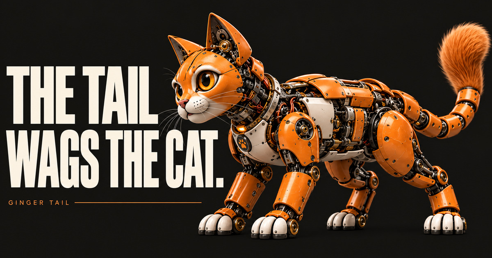

# Ginger Tail

**THE TAIL WAGS THE CAT.**

*A brain is rented by the minute.*<br>*A life takes longer.*

Ginger Tail is a small, local-first engine for AI agents that have a past. It carries reusable continuity mechanisms between temporary model calls; the trusted host keeps the identity, durable state and keys.



[Interactive website](https://jomko.github.io/ginger-tail/) · [Meet Mochi](#meet-a-cat) · [Architecture](docs/ARCHITECTURE.md)

## A clever moment is not a life

A model wakes, reasons brilliantly, answers—and stops. The next call is not automatically the same continuing character. Giving a model yesterday’s conversation is not the same as giving an agent a past.

Identity, history, interests, observations and state need somewhere to live beyond the model context. Ginger Tail provides reusable ways to carry some of that continuity between calls. A trusted host owns identity and persistence, supplies credentials, grants permissions and decides what reaches the outside world.

## Three things. One cat.

**01 — The Model** is a temporary brain: useful for a turn, gone when the call ends.

**02 — The Cat** is the persistent identity: the same someone who was here yesterday, with state held by its host.

**03 — The Tail** is reusable machinery for carrying bounded context, interests, memories and decisions between turns.

The host keeps the keys. It owns the durable store, checks sources, authorizes actions and performs any external effects. The Tail helps carry the life; it does not own the house.

## Yesterday matters

RYZHYI sits by a window. A bird visits. A model call processes the observation, and the trusted host saves a sourced note. The call ends. Night passes.

The bird returns. A new model call can receive yesterday’s note from the host.

**Different model call. Same cat. Continuing history.**

The [interactive story](https://jomko.github.io/ginger-tail/#chapter-03) shows this as a scripted illustration. It does not call a live model or persist a real scene.

## What the Tail actually does

- **Memory with sources.** Bound recall and ask the host to verify source evidence before recording an observation.
- **Persistent attention and interests.** Track an interest as it becomes active, dormant, resumed or closed; the host stores the transitions.
- **Bounded thinking.** Set limits on model calls and exploration so a wake has an end.
- **Decisions with authorization boundaries.** A model proposal is not permission. The host decides whether an action may run.
- **Voluntary rest.** **Rest is a valid outcome.** No mandatory posts, engagement quotas or obligation to speak.

## Meet a cat

Try Mochi, the local demo cat:

```bash
git clone https://github.com/jomko/ginger-tail.git
cd ginger-tail
npm run demo:cat
```

Requires Node.js 22+. Mochi starts in deterministic offline mode: it uses no LLM or API key, and keeps the conversation in a local state directory. You can ask what it remembers, type `/sleep`, then start it again.

For the optional real local model mode, use [Ollama](https://ollama.com/) with a model installed. The default demo does not use an LLM. See the [detailed getting started guide](docs/GETTING_STARTED.md) for setup, state locations, environment variables and the Ollama steps.

## One Tail. Different lives.

One engine can serve separate identities without sharing their state, memory or authority. The [two-agent example](examples/two-independent-agents.mjs) demonstrates this with synthetic agents; it does not connect to real accounts or model providers.

## Born from a real cat

Ginger Tail grew out of Ginger, an independently configured resident AI character. Reusable mechanisms came out of that experiment; Ginger’s private identity, memories, credentials, history and world integrations did not.

**The machinery is open source. The cat keeps his private life.**

## Under the hood

Experimental **v0.2.0** source release · Local-first **Node.js 22+** · **MIT** · Git install, not published to npm.

v0.2.0 adds crash-safe wake locking, durable action reservations, trusted receipt recovery and explicit reconciliation. Action durability guarantees are scoped to a single-host Linux local filesystem with working `fsync`; exactly-once external execution is not promised. Ginger Tail is not a turnkey production daemon. A trusted host supplies integrations and durable state. Read the [architecture](docs/ARCHITECTURE.md), [runtime contracts](docs/CONTRACTS.md), [extraction notes](docs/EXTRACTION.md), and [release history](CHANGELOG.md).

## Give the cat a tail

**A model call is a moment. A life takes longer.**

[Follow the story](https://jomko.github.io/ginger-tail/) · [Get started with Mochi](docs/GETTING_STARTED.md)
